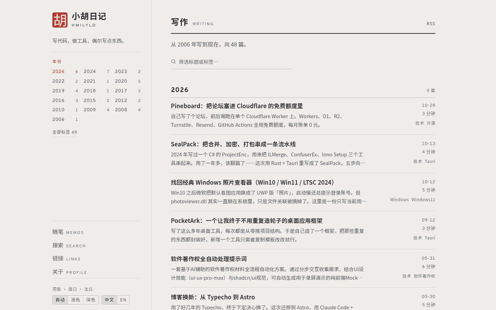
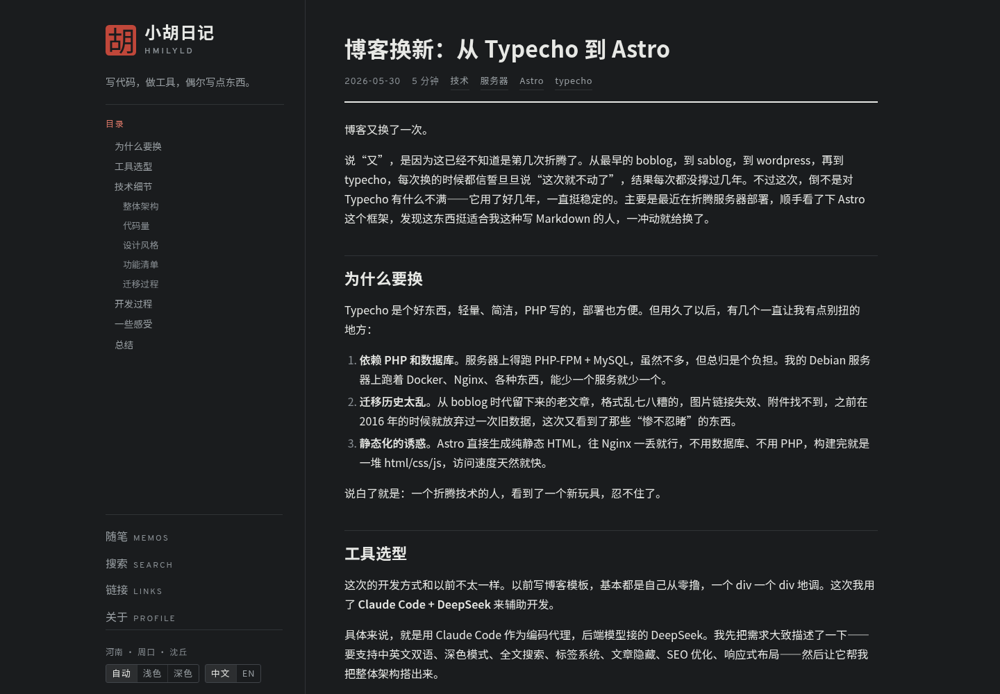
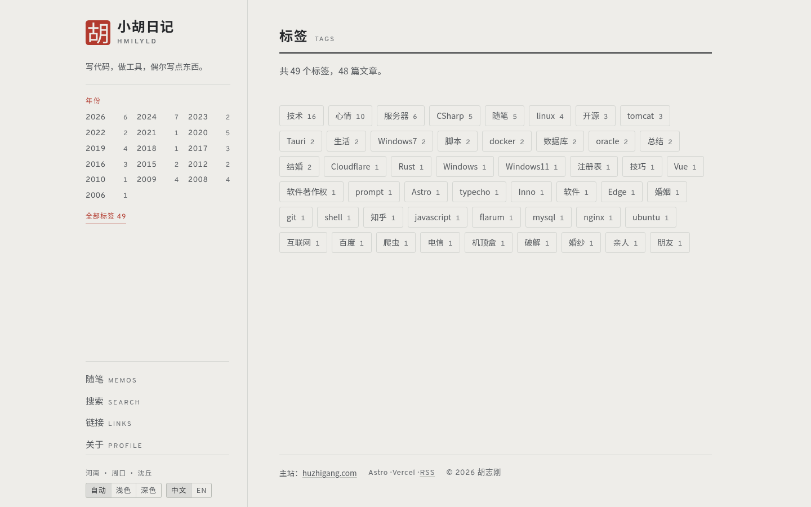
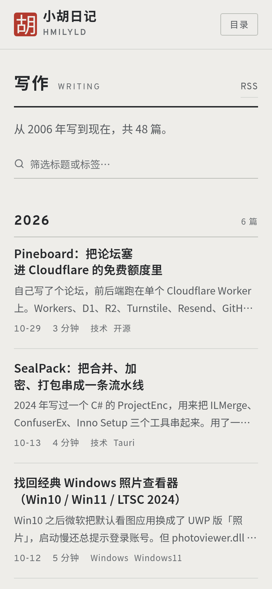

# steelseal · Steel Seal

> Steel-grey ground, iron-black type, vermilion seal.

**English** · [简体中文](README.zh-CN.md)

**A quiet [Astro](https://astro.build) blog theme built for long-form reading.** A fixed 320px index rail on the left, a 768px reading column on the right (48 CJK characters at 16px), and nothing in between: no cards, no shadows, no gradients, no modals. The whole site uses three colours, and vermilion appears only on the seal and on "you are here".

[Live demo](https://hmilyld.com) · [Design notes](DESIGN.md) · [AI agent guide](AGENTS.md) · [MIT license](LICENSE)




> Screenshots come from the theme's live deployment at [hmilyld.com](https://hmilyld.com). This repository ships demo content; the site name, author, seal character and posts are all meant to be replaced.

## Contents

- [Why this theme](#why-this-theme)
- [Design language](#design-language)
- [Pages and features](#pages-and-features)
- [Tech stack](#tech-stack)
- [Quick start](#quick-start)
- [Project structure](#project-structure)
- [Make it yours](#make-it-yours)
- [Keyboard](#keyboard)
- [Deployment](#deployment)
- [License](#license)

## Why this theme

- **Static by default.** `astro build` produces plain HTML. Drop `dist/` on any static host; no server is required.
- **No UI framework.** No React, Vue or Svelte. Theme switching, search, TOC highlighting, code copying and the mobile drawer are a few dozen lines of vanilla JS each.
- **A real design system.** Colours, type sizes, spacing, radii and motion all have a scale; the numbers are not arbitrary. Most of them carry a comment explaining why they are what they are.
- **Bilingual interface.** Chinese is server-rendered and English can be toggled on the client. The article language never changes, and `<html lang>` stays `zh-CN`.
- **Complete page set.** Archive, article, tags, search, 404, RSS, sitemap, robots and JSON-LD are all included.
- **Accessibility is not an afterthought.** Contrast is measured in both themes, headings never skip a level, the page behind the mobile drawer becomes `inert`, and focus stays visible everywhere.

## Design language

The visual system rests on three decisions: **three colours, one radius, one width.** The full rationale and the mistakes behind it live in [DESIGN.md](DESIGN.md).

### Colour

| Token                 | Light     | Dark      | Role                                            |
| --------------------- | --------- | --------- | ----------------------------------------------- |
| `--color-ground`      | `#eeede9` | `#1a1c1e` | Steel ground: page background                   |
| `--color-ink`         | `#26282b` | `#e7e8e5` | Iron ink: body text and headings                |
| `--color-soft`        | `#55595d` | `#9aa0a4` | Secondary text (6.0:1 / 6.5:1)                  |
| `--color-faint`       | `#676b6f` | `#8a9095` | Metadata (4.6:1 / 5.3:1)                        |
| `--color-rule`        | `#d4d6d2` | `#303336` | Structural rules                                |
| `--color-rule-strong` | `#b9bcb6` | `#41454a` | Control borders, stronger dividers              |
| `--color-seal`        | `#b23a2e` | `#c0473a` | Seal block: carries only the 40px glyph         |
| `--color-accent`      | `#b23a2e` | `#e07a6a` | Vermilion where it carries text (5.1:1 / 5.8:1) |

In dark mode vermilion splits into two tokens: the large glyph on the seal block can be darker, while links in body copy must stay bright. Mixing them makes one of the two fail contrast.

**Component colours always come from tokens.** There are exactly three exceptions: Shiki's inline comment colour (overridden via `[style*='#6A737D']`, 3.1:1 → 5.7:1), the dark overlay behind the mobile drawer, and the fixed light palette used for print.

### Typography

All fonts are self-hosted through Fontsource; there are no third-party font requests:

| Typeface       | Role                                                     |
| -------------- | -------------------------------------------------------- |
| Noto Sans SC   | Chinese body copy, headings and interface                |
| Overpass       | Latin wordmark, dates, years, metadata, uppercase labels |
| JetBrains Mono | Code blocks and inline code                              |

- Body copy is `16px / 1.75`, with generous paragraph spacing; Chinese long-form reading comes first.
- The type scale is explicit: article title 32px, page title 24px, body h2 22.4px, h3 17.9px, body 16px, excerpt 14.4px, metadata 12.8px, micro labels 12px. **12px is the floor.** No text that carries information goes below it.
- Tracking is assigned by role, from `0.01em` in body copy to `0.26em` in the Latin wordmark. Values are not added casually.
- Measure is set once by `.pane-inner` at `48rem`: body copy, code, tables and images share the same right edge.

### Layout

```text
┌──────────────┬────────────────────────────┐
│ rail 320px   │ pane                       │
│              │  ┌──────────────────────┐  │
│  seal + name │  │ pane-inner 768px     │  │
│  year index /│  │                      │  │
│  article TOC │  │  prose / code / table│  │
│  page nav    │  │  all the same width  │  │
│  theme/lang  │  └──────────────────────┘  │
└──────────────┴────────────────────────────┘
```

- `--shell-max: 75rem` (1200px) = 320 rail + 56 gap + 768 content + 56 gap.
- The rail is `position: sticky`; only the middle section (years or TOC) scrolls, while identity and bottom controls stay in place.
- Breakpoints are `1199 / 1072 / 1024 / 860`. Below 860px the rail becomes a drawer; when closed it is `visibility: hidden`, so its links leave the tab order completely.
- On short pages, the flex column in `.pane` pushes the footer to the bottom of the viewport.

### Components and states

| Component        | Treatment                                                                                                |
| ---------------- | -------------------------------------------------------------------------------------------------------- |
| Button `.btn`    | 32px min height, 3px radius, 1px border; hover moves to ink, active adds a 7% ink wash                   |
| Tag `.tag`       | Three presentations share one palette: tag-cloud chip, underlined article metadata, static inline label  |
| Row `.row`       | `1fr 10rem` grid; the right column holds date, reading time and tags                                     |
| Section head     | 2px ink underline + title + uppercase sublabel; 2px marks page-level divisions, 1px separates rows       |
| Segmented `.seg` | Shared by theme (auto / light / dark) and language (中文 / EN)                                           |
| Search field     | Focus indicator lives on the bottom rule: 1px border + 1px shadow stack into a 2px vermilion line        |
| Reading progress | A 2px vermilion line pinned to the top of the viewport, scaled by scroll position                        |
| Code copy        | Injected at the top-right of each code block; always visible on touch, revealed on hover for pointer use |

Interaction states are consistent: **hover** moves toward ink or vermilion over 150ms; **focus-visible** is a 2px vermilion outline with 3px offset; **active** adds an ink wash; **disabled** is 45% opacity. Motion has only two durations: `150ms` for hover and press, `200ms` for theme changes and the drawer, with `ease` throughout. Everything is disabled under `prefers-reduced-motion`.

On accessibility: body and secondary text are all ≥4.5:1; every page exposes exactly one `h1`; the home page hierarchy is `h1 → h2 Writing → h3 year → h4 post`; the skip link is the first tab stop; opening the drawer sets `main` to `inert`, Esc closes it and returns focus; touch targets are at least 24×24.

## Pages and features

| Route                                           | What it does                                                                           |
| ----------------------------------------------- | -------------------------------------------------------------------------------------- |
| `/`                                             | Archive: all posts grouped by year, with a title/tag filter and rail scroll-spy        |
| `/posts/[slug]`                                 | Article: rail TOC, reading progress, prev/next, related posts by tag, code copy        |
| `/tags`, `/tags/[tag]`                          | Tag cloud (indexable) and tag detail pages (`noindex`)                                 |
| `/search`                                       | Local search over titles, tags and excerpts; hit highlighting; 8 recent posts if empty |
| `/[page]`                                       | Static pages from `src/content/pages/*.md` (e.g. `/about`, `/links`)                   |
| `/404`                                          | 404 page with five recent posts and ways to continue                                   |
| `/rss.xml`, `/sitemap-index.xml`, `/robots.txt` | Generated; search, tag detail and hidden posts are excluded from the sitemap           |
| `/search.json`                                  | Build-time search index fetched by the client                                          |

### Screenshots

All screenshots below come from the live demo: article page (dark), tag page, and mobile.





<p align="center">
  
</p>

## Tech stack

| Layer        | Choice                                                                                                |
| ------------ | ----------------------------------------------------------------------------------------------------- |
| Framework    | Astro 7, static output, Content Collections + `glob` loader                                           |
| Styling      | Tailwind CSS 4 via `@tailwindcss/vite` only; components live in `@layer components`, not utility soup |
| Language     | TypeScript (`astro/tsconfigs/strict`) + `.astro` components                                           |
| Fonts        | `@fontsource-variable/*`: Overpass, Noto Sans SC, JetBrains Mono                                      |
| Highlighting | Shiki (`github-dark`), with the comment colour overridden separately                                  |
| Feeds / SEO  | `@astrojs/rss`, `@astrojs/sitemap`, JSON-LD, Open Graph, Twitter Card                                 |
| Runtime      | No UI framework, no client-side router, no third-party scripts                                        |

## Quick start

Requires Node >= 22.12. pnpm, npm or yarn all work; the examples use pnpm.

```sh
pnpm install
pnpm dev        # http://localhost:4321
pnpm build      # → dist/
pnpm preview    # preview the build
```

Other scripts:

```sh
pnpm check         # astro check (types + templates)
pnpm lint          # eslint
pnpm format        # prettier --write
pnpm format:check  # prettier --check
```

Before going live, change `site` in `astro.config.mjs` to your domain. Canonical URLs, `og:url`, RSS and the sitemap all read from it. The live example is `https://hmilyld.com`.

## Project structure

```text
.
├── astro.config.mjs              # site, sitemap filter, Shiki, Tailwind plugin
├── README.md / README.zh-CN.md   # English / Chinese project introduction
├── DESIGN.md / DESIGN.zh-CN.md   # English / Chinese design system
├── AGENTS.md / AGENTS.zh-CN.md   # English / Chinese AI agent guide
├── docs/screenshots/             # README screenshots
├── public/                       # favicon, og-image and other copied assets
└── src/
    ├── config.ts                 # Site identity: name, author, seal, nav, socials
    ├── content.config.ts         # posts / pages frontmatter schemas
    ├── styles/global.css         # Design system: tokens + components + responsive + print
    ├── layouts/
    │   └── BaseLayout.astro      # Shell: SEO, theme, i18n, progress, code copy, shortcuts
    ├── components/
    │   ├── SiteRail.astro        # Rail: identity, year index / TOC, nav, theme and language
    │   ├── Seal.astro            # Vermilion seal
    │   ├── Toc.astro             # Article TOC (rendered inside the rail)
    │   ├── PostRows.astro        # Shared post rows (home, tags, 404, related posts)
    │   └── PageLayout.astro      # Static page layout
    ├── pages/                    # Routes plus RSS / sitemap / search index
    ├── utils/posts.ts            # Sorting, year grouping, tag counts, reading time
    └── content/
        ├── posts/                # Markdown posts
        └── pages/                # Markdown static pages
```

## Make it yours

### 1. Site identity: `src/config.ts`

```ts
export const SITE = {
  title: 'Steel Seal Journal', // Site name: <title> suffix and rail h1
  latin: 'STEELSEAL', // Latin wordmark under the name
  description: '……', // meta description
  author: 'Your Name', // JSON-LD, RSS and footer copyright
  seal: '印', // One CJK character inside the seal
  tagline: '……', // One or two lines in the rail
  place: 'Henan · Zhoukou', // Rail location line; can be removed
  favicon: '/favicon.svg',
  socials: ['https://github.com/yourname'],
  nav: [
    { key: 'search', href: '/search', zh: '搜索', en: 'Search' },
    { key: 'links', href: '/links', zh: '链接', en: 'Links' },
    { key: 'about', href: '/about', zh: '关于', en: 'Profile' },
  ],
};
```

Each `nav[].key` maps to a `nav.*` entry in the i18n dictionary in `BaseLayout.astro`. When you add an item, update both places.

### 2. Design tokens: `src/styles/global.css`

The `:root` block at the top of the file is the entire look of the site:

```css
:root {
  --color-ground: #eeede9; /* steel ground */
  --color-ink: #26282b; /* iron ink */
  --color-seal: #b23a2e; /* vermilion seal */

  --shell-max: 75rem; /* total page width */
  --rail-w: 320px; /* rail width */
  --gutter: 3.5rem; /* page gutters */
  --radius: 3px; /* the only radius */
  --dur: 150ms; /* the only interaction duration */
}
```

`.dark` holds the dark-mode counterparts. When you change a colour, update the measured contrast comments such as `/* 6.0:1 on ground */` with it; those are measurements, not decoration.

### 3. Content

Posts live in `src/content/posts/`. The filename is arbitrary; the URL comes from frontmatter.

```md
---
title: Title # required
date: 2026-01-12 # required
tags: [design, typography] # optional
excerpt: One-sentence summary # optional; used on home and tag pages
slug: custom-slug # optional; overrides the URL
hidden: false # optional; true removes it from lists and sitemap and adds noindex
---

Body copy in Markdown.
```

Write images as raw HTML with dimensions and lazy loading. Markdown's `` carries no width or height, so the page jumps while loading:

```html
<figure>
  
  <figcaption>Caption</figcaption>
</figure>
```

Static pages live in `src/content/pages/`; the filename is the path (`about.md` → `/about`).

## Keyboard

| Key   | Action                                                  |
| ----- | ------------------------------------------------------- |
| `/`   | Jump to search (or the archive filter on the home page) |
| `Esc` | Close the mobile drawer                                 |
| `Tab` | Every focus stop gets a 2px vermilion outline           |

## Deployment

The build is fully static. Hand `dist/` to any static host:

```sh
pnpm build
```

Vercel, Netlify, Cloudflare Pages and GitHub Pages all work without an adapter. If you need Vercel's on-demand rendering (for example, adding an API route), install `@astrojs/vercel` and register it in `astro.config.mjs`.

## License

MIT, copyright © 2026 [hmilyld.com](https://hmilyld.com). See [LICENSE](LICENSE).

Demo copy in `src/content/` is yours to replace. Screenshots come from [hmilyld.com](https://hmilyld.com) and are used only to show the theme in production. Fonts are self-hosted through Fontsource under their respective SIL Open Font Licenses.
